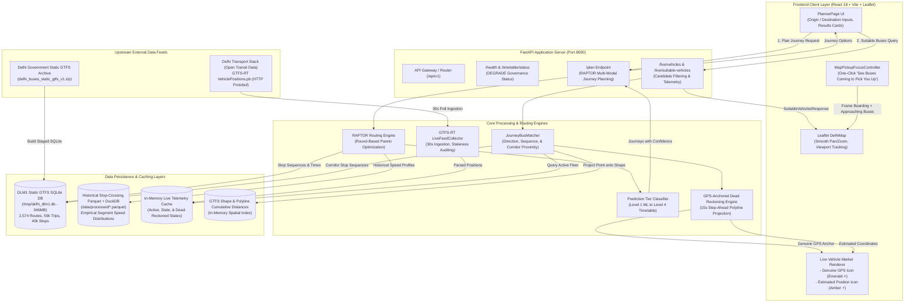

# System Architecture — Delhi Real-Time Bus Journey Planner

This document provides a comprehensive technical overview and architecture diagram of the Delhi Real-Time Bus Journey Planner. The architecture is derived directly from the active codebase.

---

## 1. End-to-End System Architecture Diagram

---

## 2. Component Breakdown

### 2.1 Frontend Client Layer
- **Framework**: React 18 with TypeScript, Vite bundler, and Tailwind CSS.
- **Mapping Engine**: Leaflet with `react-leaflet`, rendering true Delhi road geometry from static GTFS `shapes` rather than straight-line Euclidean interpolation.
- **Visual Distinction**:
  - **Genuine GPS Positions**: Rendered with solid emerald badges, timestamped from the actual hardware ping.
  - **Estimated Positions (Dead Reckoned)**: Rendered with amber lightning badges (`⚡`), displaying accumulated drift and dead-reckoning elapsed seconds.
- **Dynamic Camera Control**:
  - `MapPickupFocusController`: Automatically bounds the viewport to include both the user's boarding stop and all approaching pickup buses along the corridor.
  - `Center on Journey`: Allows the user to toggle back to the full trip corridor.

### 2.2 FastAPI Backend Layer
- **Endpoints**:
  - `POST /api/v1/plan`: Computes multi-modal transit itineraries using the RAPTOR algorithm with Pareto criteria (arrival time, transfers, walking distance).
  - `GET /api/v1/live/suitable-vehicles`: Evaluates candidate vehicles for a specific journey leg, applying strict directional and stop sequence verification.
  - `GET /api/v1/live/vehicles`: Viewport-aware live bus discovery across the entire Delhi fleet.
  - `GET /api/v1/live/status`: Upstream feed health, active vehicle counts, and timestamp synchronization.
  - `GET /api/v1/health`: Overall system health and governance disclosures.

### 2.3 Real-Time Matching & Dead Reckoning Pipeline
1. **Corridor Proximity Gate**: Candidate vehicles must be within 1,500m of the GTFS route shape.
2. **Direction Alignment Gate**: Vehicle bearing must match corridor heading within 120° (or local segment heading).
3. **Stop Sequence Progress Gate**: The vehicle's current projection must be upstream of the boarding stop (`board_seq < alight_seq` and `nearest_seq <= board_seq`). Buses that have already departed the boarding stop are rejected as `ALREADY_PASSED_BOARDING_STOP`.
4. **GPS-Anchored Dead Reckoning**:
   - Calculates movement along the GTFS shape polyline every 15 seconds based on speed.
   - Genuine GPS fixes act as recalibration anchors.
   - Anomaly detection (`LARGE_PREDICTION_ERROR > 250m`, `AMBIGUOUS_SHAPE_PROJECTION`, `UNEXPECTED_BACKWARD_PROGRESS`) automatically freezes unverified forward extrapolation and falls back to the genuine GPS anchor.

---

## 3. Data Persistence & Governance

| Layer | Storage Engine | Path / Format | Description |
| :--- | :--- | :--- | :--- |
| **Static GTFS** | SQLite 3 | `/tmp/delhi_dlm1.db` | Complete Delhi bus network (2,574 routes, 40,000+ stops, 59,000+ trips). |
| **Historical Speeds** | Apache Parquet + DuckDB | `data/processed/*.parquet` | Empirical stop-crossing segment durations from Delhi pilot GPS data. |
| **Real-Time Feed** | Protocol Buffers (GTFS-RT) | In-Memory Collector | Ingested via Delhi Transport Stack (`VehiclePositions.pb`). |
| **Operational Governance** | JSON Envelopes | System-Wide | Governing status strictly retained as `DEGRADE` due to expired calendar dates in static GTFS. |
