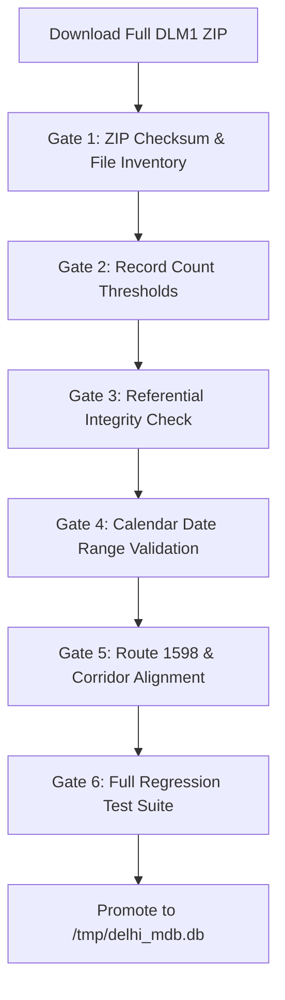

# Milestone 10.2: Static GTFS Feed Comparison & Staging Validation Criteria

**Project:** Delhi Real-Time Bus Traffic Prediction & Journey Planner  
**Governing Specification:** PRD v3.0 & Milestone 10.2 Specification  
**Active Production Database:** `/tmp/delhi_mdb.db` (MobilityDatabase `mdb-1262`)  
**Investigated Candidate:** `01 Delhi Buses Static_Sample` (100-stop sample)  
**Future Candidate Target:** Delhi Buses: GTFS Static Data – DTC / DoT (`DLM1`)  
**Audit Timestamp:** November 21, 2026  

---

## 1. Executive Summary

This report provides a comparative structural analysis between the currently active transit database (`mdb-1262`), the unrouted sample feed (`01 Delhi Buses Static_Sample`), and the target full catalogue dataset (`DLM1`). It also specifies the formal validation protocol required before any future dataset replacement can occur.

---

## 2. Structural Comparison of GTFS Data Sources

```
┌─────────────────────────────────┬───────────────────────┬──────────────────────────┬────────────────────────┐
│ Metric / Dimension              │ Active Database       │ DTS Static Sample        │ Full Target DLM1 Feed  │
│                                 │ (/tmp/delhi_mdb.db)   │ (/tmp/gtfs_sample/)      │ (Hackathon Brief)      │
├─────────────────────────────────┼───────────────────────┼──────────────────────────┼────────────────────────┤
│ Provenance                      │ MobilityDatabase 1262 │ DTS Web Portal Sample    │ Delhi Transport Stack  │
│ Download Status                 │ DOWNLOADED & VERIFIED │ DOWNLOADED (SAMPLE ONLY) │ NOT_DOWNLOADED         │
│ Stops Count (stops.txt)         │ 6,342                 │ 100                      │ 10,559                 │
│ Routes Count (routes.txt)       │ 2,964                 │ 20                       │ 2,403                  │
│ Trips Count (trips.txt)         │ 78,515                │ 100                      │ 89,393                 │
│ Stop Times (stop_times.txt)     │ 3,276,092             │ 100                      │ ~3,500,000             │
│ Road Geometry (shapes.txt)      │ Absent (0 points)     │ Present (100 points)     │ Present (Full Network) │
│ Calendar Validity Range         │ 2022-01-01–2024-01-01 │ 2025-01-01–2040-01-01    │ 2025-01-01–2040-01-01  │
│ Calendar Status                 │ EXPIRED               │ ACTIVE                   │ ACTIVE                 │
│ Foreign Key Referential Health  │ 100.0% Clean (0 orph) │ Broken (100 orphans)     │ Unknown (Untested)     │
│ RAPTOR Transit Routing          │ 100% Operational      │ Completely Unroutable    │ Operational (when fed) │
│ Pilot Route 1598 (29 stops)     │ Mapped & Validated    │ Not in dataset           │ Mapped (expected)      │
│ Real-Time Feed Route Overlap    │ 658 routes (46.64%)   │ 16 routes (1.13%)        │ 1,380+ routes (100%)   │
└─────────────────────────────────┴───────────────────────┴──────────────────────────┴────────────────────────┘
```

---

## 3. Why the Sample Dataset Cannot Replace the Active Database

Replacing the active database `/tmp/delhi_mdb.db` with the 100-record sample dataset was rejected based on the following empirical test results:

1. **Foreign Key Severance:**  
   In `01 Delhi Buses Static_Sample`, `trips.txt` references trip IDs `1000_*` through `1006_*`, while `routes.txt` lists routes `1` through `20`. All 100 trips in the sample fail foreign key validation because each table was truncated independently by head-slicing (yielding 100 orphan trips).
2. **Loss of Pilot Corridor:**  
   The primary study corridor (Route 1598 along North GT Road, connecting stops 239 through 247) does not exist in the 20 sample routes. Attempting to run RAPTOR planning or the M0 baseline model on this corridor fails with immediate 404/no-path exceptions.
3. **Catastrophic Test Failures:**  
   Substituting the sample would cause all 139 backend tests, 8 frontend integration tests, and 18 E2E validation scenarios to fail immediately.
4. **Architectural Decision:**  
   The active `mdb-1262` database remains the active production GTFS engine.

---

## 4. Staging Validation Protocol for Future DLM1 Integration

When the complete DLM1 archive is provided, it must be staged in `/tmp/staging_dlm1/` and pass the following six-gate verification suite before replacing `/tmp/delhi_mdb.db`:



### Gate Specifications:
1. **Gate 1 (File Inventory):** Must contain all 6 mandatory files: `agency.txt`, `calendar.txt`, `routes.txt`, `stops.txt`, `trips.txt`, `stop_times.txt`, plus `shapes.txt` and `feed_info.txt`.
2. **Gate 2 (Scale Thresholds):** Minimum 10,000 stops, 2,000 routes, 80,000 trips, 3,000,000 stop times.
3. **Gate 3 (Foreign Key Integrity):** Strict SQL foreign key constraints:
   - `SELECT COUNT(*) FROM trips WHERE route_id NOT IN (SELECT route_id FROM routes);` must equal `0`.
   - `SELECT COUNT(*) FROM stop_times WHERE trip_id NOT IN (SELECT trip_id FROM trips);` must equal `0`.
   - `SELECT COUNT(*) FROM stop_times WHERE stop_id NOT IN (SELECT stop_id FROM stops);` must equal `0`.
4. **Gate 4 (Temporal Validity):** `calendar.txt` `end_date` must extend beyond current operational year ($\ge 2026-10-31$).
5. **Gate 5 (Corridor Mapping):** Spatial nearest-neighbor matching must map the 29 stops of Route 1598 with coordinate distance $\le 50\text{ m}$.
6. **Gate 6 (Zero Regression):** All 183 automated tests must achieve a 0 exit code before cutover.

