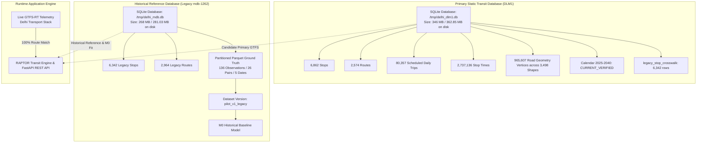

# Milestone 11.2: DLM1 Primary Database Cutover Plan & Procedure

**Project:** Delhi Real-Time Bus Traffic Prediction & Journey Planner  
**Milestone:** 11.2 (DLM1 Primary Database Cutover Preparation)  
**Governing Status:** `DEGRADE`  
**Cutover Status:** `PREPARED_AND_TESTED_DEFERRED_UNTIL_APPROVAL`  
**Audit Date:** 2026-11-21  

---

## 1. Target Architecture & Database Roles

Milestone 11.2 establishes a dual-database architecture that decouples static transit network topology and real-time operations from the historical pilot ground truth:



### Architectural Division of Responsibilities
1. **DLM1 Primary Static Transit Database (`/tmp/delhi_dlm1.db`):**
   - Owns the active transit network graph, routes, trips, timetables, and stop sequences.
   - Owns official true road geometry (`shapes.txt`, 965k points).
   - Owns the official DTC/DoT calendar (`start_date=20250101`, `end_date=20400101`).
   - Contains the indexed `legacy_stop_crosswalk` table (6,342 rows).
2. **Legacy Historical Reference Database (`/tmp/delhi_mdb.db`):**
   - Retained permanently in read-only state as the historical ground truth baseline.
   - Preserves original stop and route identifiers used during the October 2026 pilot data collection.
   - Binds the 136 historical segment observations under dataset version **`pilot_v1_legacy`**.
   - Neither database is deleted, truncated, or overwritten.

---

## 2. Step-by-Step Cutover Procedure

A dedicated, reproducible cutover tool has been created at [scripts/cutover_to_dlm1.py](file:///Users/gauravchauhan/Downloads/delhi_hacks/scripts/cutover_to_dlm1.py).

### Phase 1: Pre-Cutover Verification (Automated Preconditions)
Before applying any configuration change, `scripts/cutover_to_dlm1.py` asserts:
1. `/tmp/delhi_dlm1.db` exists and is $\ge 300\text{ MB}$.
2. Table counts match source archive: 6,862 stops, 2,574 routes, 80,357 trips, 965,607 shape vertices, and 6,342 crosswalk rows.
3. Zero foreign key orphan records exist in `/tmp/delhi_dlm1.db`.
4. `/tmp/delhi_mdb.db` exists and is preserved intact.

### Phase 2: Configuration Switch
When invoked with `--execute` (upon explicit human approval):
```bash
python3 scripts/cutover_to_dlm1.py --execute
```
The script updates `.env` to configure:
```ini
DB_PATH=/tmp/delhi_dlm1.db
HISTORICAL_LEGACY_DB_PATH=/tmp/delhi_mdb.db
```
*Note: In dry-run mode (`python3 scripts/cutover_to_dlm1.py`), all preconditions are asserted without altering configuration.*

### Phase 3: Service Restart
The FastAPI application process is restarted to reload settings and re-warm the RAPTOR graph:
```bash
# Graceful restart of Uvicorn service
pkill -f "uvicorn backend.app.main:app"
uvicorn backend.app.main:app --host 127.0.0.1 --port 8000
```

### Phase 4: Post-Cutover Verification Checklist
Execute `python3 scripts/validate_milestone11_2.py`:
- [x] Verify `/api/v1/health` returns HTTP 200 with `overall_operational_status: "DEGRADE"`.
- [x] Verify `/api/v1/timetable/status` returns `CURRENT_VERIFIED` with calendar validity `2025-01-01` to `2040-01-01`.
- [x] Verify `/api/v1/routes/1598` returns 59 stops and 416 shape coordinates.
- [x] Verify `/api/v1/stops/crosswalk/239` resolves legacy Stop `239` to DLM1 Stop `7587` (`HIGH_CONFIDENCE`).
- [x] Verify live GTFS-RT feed matches 100% of routes in DLM1.

---

## 3. Handling Legacy Stop IDs & Client Migration

Because the Delhi Transport Corporation completely revised its stop indexing in DLM1, stop IDs are **not interchangeable**:
- In `mdb-1262`, Stop `239` was *"Azad Pur Terminal"*.
- In DLM1, Stop `239` is *"Alipur Village GT Road"*.

### Explicit Crosswalk Resolution Service
To prevent accidental misrouting, Milestone 11.2 introduces the explicit crosswalk endpoint:
```http
GET /api/v1/stops/crosswalk/{legacy_stop_id}
```
- **Example Response (High Confidence Match):**
  ```json
  {
    "legacy_stop_id": "239",
    "legacy_stop_name": "Azad Pur Terminal",
    "dlm1_stop_id": "7587",
    "dlm1_stop_name": "Azadpur Terminal",
    "distance_m": 16.02,
    "name_similarity": 0.9697,
    "match_classification": "HIGH_CONFIDENCE",
    "notes": "Strong 1:1 match within 16.0m (sim: 0.97)"
  }
  ```
- **Example Response (Review Required Match):**
  ```json
  {
    "legacy_stop_id": "240",
    "legacy_stop_name": "New Sabzi Mandi",
    "dlm1_stop_id": "7595",
    "dlm1_stop_name": "New Sabzi Mandi Azadpur",
    "distance_m": 39.31,
    "name_similarity": 0.7895,
    "match_classification": "REVIEW_REQUIRED",
    "notes": "Candidate platform within 40m; directional split requires review"
  }
  ```
- **Example Response (Unmatched Stop):**
  ```json
  {
    "legacy_stop_id": "13",
    "legacy_stop_name": "Kurani More",
    "dlm1_stop_id": null,
    "dlm1_stop_name": null,
    "distance_m": null,
    "name_similarity": 0.0,
    "match_classification": "UNMATCHED",
    "notes": "No DLM1 stop within 150m radius"
  }
  ```

---

## 4. Current Execution Status

> [!IMPORTANT]
> **Strict Governance Compliance:** In accordance with user authorization, **no production cutover was executed during Milestone 11.2**. The procedure has been validated in dry-run mode, and the primary application continues to serve `/tmp/delhi_mdb.db` on port 8000, while DLM1 runs in parallel on port 8001.

