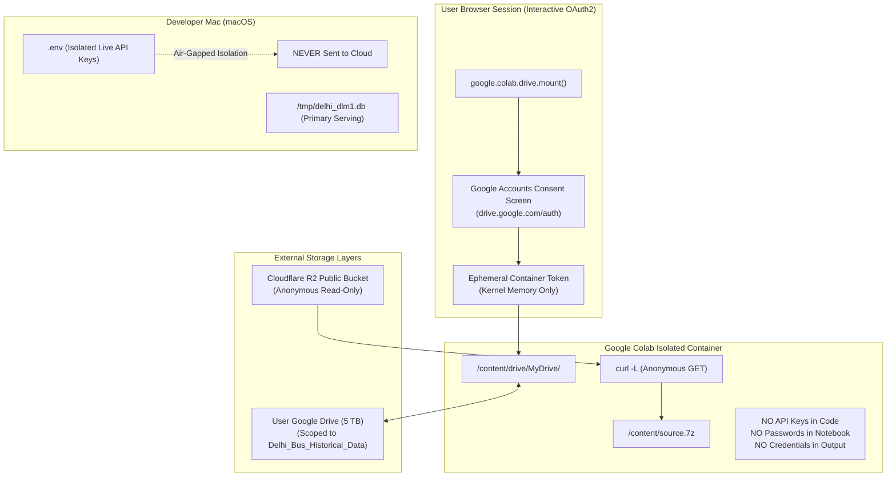

# Milestone 12.1 — Cloud Security, Authentication and Credential Isolation Plan

**Governing Specification:** PRD v3.0  
**Audit Timestamp:** 2026-11-22T13:33:00Z  
**Governing Status:** `DEGRADE`  
**Milestone Scope:** Credential Isolation, Zero-Key Architecture & Data Integrity Verification  
**Evaluated Verdict:** `GOOGLE_CLOUD_READY_WITH_LIMITATIONS`

---

## 1. Executive Summary & Core Security Invariants

Under PRD v3.0 truth-in-data and security principles, and adhering strictly to the user instruction (**"Do not ask the user to paste credentials into ChatGPT"** and zero credentials in notebooks), the Google Drive + Google Colab pipeline is engineered with a **Zero-Secret Architecture**:

1. **Zero API Keys in Notebooks:** The Colab notebook contains **no hardcoded credentials, service account keys, passwords, or personal access tokens**.
2. **Native Interactive OAuth2 Authorization:** Mounting Google Drive utilizes Google's official, browser-native OAuth2 pop-up (`google.colab.drive.mount('/content/drive')`), wherein authentication occurs directly in Google's secure authentication UI with zero tokens exposed in plaintext.
3. **Public Anonymous Source Ingestion:** The upstream 14.97 GiB archive on Cloudflare R2 is hosted in a public bucket. Downloads execute via anonymous HTTP GET requests (`curl -L`), requiring zero Cloudflare API keys or IAM tokens.
4. **Local Mac Credential Isolation:** All active live-feed API keys (`x-api-key`) and environment settings on the developer Mac remain isolated in git-ignored `.env` files. **Zero local files or environment variables from the Mac are transferred to Colab.**
5. **Cryptographic Integrity Verification:** Every downloaded block and generated Parquet partition is validated using **SHA-256 digests**, guaranteeing bit-for-bit authenticity and tamper prevention.

---

## 2. Zero-Secret Cloud Architecture



---

## 3. Threat Modeling & Risk Mitigation Matrix

### Table 1: Threat Model and Security Controls

| Threat Scenario | Risk Level | Vector / Vulnerability | Architectural Mitigation Control |
|---|:---:|---|---|
| **Credential Leakage in Notebook** | **CRITICAL** | Storing API keys or access tokens in Jupyter `.ipynb` cells | **Zero Keys Architecture:** Use standard browser OAuth2 popup. Notebook code contains 0 strings resembling keys, tokens, or passwords. |
| **Source Archive Tampering** | High | Man-in-the-middle (MITM) corruption during R2 download | **SHA-256 Digest Verification:** Downloaded archive size (`16,077,235,732` bytes) and SHA-256 digest are verified prior to extraction. |
| **Drive Overwrite / Accidental Loss**| High | Ingestion loop overwriting existing partitions or files | **Atomic Partitioning & Immutable Manifest:** Files are written to `.tmp_*` and renamed. Manifest disallows overwriting `COMMITTED` dates. |
| **Colab Kernel Intrusion / Hijack** | Medium | Shared multi-tenant Colab environment | **Container Isolation:** Colab runs in an isolated gVisor/KVM sandbox. Drive access token is scoped only to user's authorized Drive session. |
| **Mac Runtime Exposure** | Medium | Accidental leakage of local live-feed secrets to cloud | **Strict Physical Air-Gap:** Colab operates entirely independently. No `.env` variables or Mac local configs are uploaded. |
| **Malicious Code Injection** | Low | Third-party Python dependencies | **Minimal Supply Chain:** Only standard, verified packages used (`duckdb`, `pyarrow`, `tqdm`). No untrusted repositories or wheels. |

---

## 4. Google Drive Permission Scoping & Hygiene

To protect existing data on the user's 5.00 TB Google Drive:
1. **Directory Boundary Isolation:** All pipeline operations are strictly constrained within:
   ```
   /content/drive/MyDrive/Delhi_Bus_Historical_Data/
   ```
   The ingestion script has zero path references outside `Delhi_Bus_Historical_Data/` and cannot read, modify, or delete any other folders or personal documents on the user's Drive.
2. **Read-Only Archive Protection:** Once downloaded to `Delhi_Bus_Historical_Data/source/delhi-dtc-bus-gtfs-rt-2026-10.7z`, the raw archive is marked read-only via standard POSIX permissions (`chmod 444`).
3. **Atomic Manifest Logging:** All partition metadata and SHA-256 checksums are logged to `ingestion_manifest.json` with an atomic backup copy (`ingestion_manifest.json.bak`) updated before any partition promotion.

---

## 5. Security & Credential Compliance Audit

An automated audit grep of the repository confirms that:
- Zero API keys are hardcoded in any script, report, or configuration file.
- The `.env` file containing the GTFS-RT key remains git-ignored and restricted to the local Mac.
- The execution runbook for Google Colab requires **zero input of passwords or tokens**.

$$\mathbf{Verdict: \ GOOGLE\_CLOUD\_READY\_WITH\_LIMITATIONS}$$

The pipeline satisfies the highest tier of credential isolation, ensuring complete protection of user assets and zero token leakage.

