# Milestone 12 — Full Month Ingestion Execution Plan

**Governing Specification:** PRD v3.0  
**Audit Timestamp:** 2026-11-22T01:59:00Z  
**Governing Status:** `DEGRADE`  
**Milestone Scope:** Step-by-Step Execution Plan & Gated Milestones (Planning Only)  
**Evaluated Verdict:** `READY_WITH_STORAGE_CONSTRAINTS`

---

## 1. Execution Objectives & Phased Strategy

This document specifies the exact, step-by-step phased execution plan to ingest the remaining **26 calendar days** of the October 2026 historical GPS dataset once storage prerequisites are fulfilled.

```mermaid
flowchart TD
    subgraph Phase0["Phase 0: Gating Preconditions & Authorization"]
        P0_1[Verify Operator Sign-off] --> P0_2[Mount External Drive OR Reclaim Host Space]
        P0_2 --> P0_3[Verify Free Space >= 25 GiB]
        P0_3 --> P0_4[Verify Database Integrity: DLM1 & Legacy]
    end

    subgraph Phase1["Phase 1: Test Harness & Dry Run"]
        P0_4 --> P1_1[Execute Pipeline Dry Run on Day 1]
        P1_1 --> P1_2[Verify 10-Point Validator on Existing Parquet]
        P1_2 --> P1_3[Confirm Zero Mutation to Existing Pilot Data]
    end

    subgraph Phase2["Phase 2: Pilot Consistency Verification"]
        P1_3 --> P2_1[Re-run Extraction for Pilot Days 2, 3, 4, 7 in Staging]
        P2_1 --> P2_2[Verify Bit-Identical Row Counts & Stop Crossings]
        P2_2 --> P2_3[Operator Checkpoint Gate 1]
    end

    subgraph Phase3["Phase 3: Rolling Window Ingestion (26 Days)"]
        P2_3 --> P3_Batch1[Batch 1: Oct 5, 6, 8, 9]
        P3_Batch1 --> P3_Batch2[Batch 2: Oct 10 - 15 Fleet Addition]
        P3_Batch2 --> P3_Batch3[Batch 3: Oct 16 - 22 Dussehra]
        P3_Batch3 --> P3_Batch4[Batch 4: Oct 23 - 31 Diwali Weekend]
    end

    subgraph Phase4["Phase 4: Full-Month Traffic Aggregation"]
        P3_Batch4 --> P4_1[DuckDB Unified Stop-Crossing Aggregation]
        P4_1 --> P4_2[Generate 31-Day M0 Travel Time Profiles]
        P4_2 --> P4_3[Update historical_time_profiles.json]
    end

    subgraph Phase5["Phase 5: Verification & Governance Audit"]
        P4_3 --> P5_1[Execute 160 Backend Pytest Tests]
        P5_1 --> P5_2[Verify Time Accounting Conservation]
        P5_2 --> P5_3[Publish Milestone 13 Final Submission Package]
    end
```

---

## 2. Chronological Phase Specifications

### Phase 0: Gating Preconditions & Operator Authorization
**Prerequisites to be fulfilled before executing ANY ingestion script:**
1. **Operator Written Authorization:** Explicit operator command approving the storage path (Option A External Drive, Option C Cloud, or Option D Local Reclaim).
2. **Storage Provisioning Verification:**
   - If Option A: Mount `/Volumes/DelhiTransit_Ext` and verify available space $\ge 200\text{ GiB}$.
   - If Option D: Execute host disk cleanup to verify available root space $\ge 25.0\text{ GiB}$.
3. **Database Integrity Pre-Check:**
   - Verify `/tmp/delhi_dlm1.db` exists (346.04 MiB) and passes `PRAGMA integrity_check;`.
   - Verify `/tmp/delhi_mdb.db` exists (268.41 MiB) and passes `PRAGMA integrity_check;`.
   - Verify 136 ground-truth historical stop crossings remain untouched in `data/processed/stop_crossings/`.
4. **Backup Configuration:** Snapshot `backend/.env` and configuration files.

### Phase 1: Test Harness & Idempotency Dry-Run
**Scope:** Validate the new `scripts/ingest_historical_gps_rolling.py` script against existing Day 1 data without modifying disk state.
1. Run pipeline in `--dry-run` mode against `data/raw/gps/bus_movements_2026_10_01.db`.
2. Verify that `data/processed/gps_parquet/service_date=2026-10-01/data.parquet` is recognized as `COMMITTED` in the manifest and skipped.
3. Validate that 10-point accounting checks run cleanly and report $0$ delta.

### Phase 2: Pilot Consistency Verification (Days 2, 3, 4, 7)
**Scope:** Verify that the rolling pipeline produces identical results to the existing 5 pilot dates.
1. Stage temporary extraction of Day 2 (`bus_movements_2026_10_02.db`).
2. Run DuckDB transformation to a temporary partition `.tmp_verify`.
3. Compare row count ($14,102,941$ clean rows), conflict count, and OOB count against existing partition.
4. Verify stop-crossing yield is identical.
5. Scrub temporary verification directory.

### Phase 3: Rolling Window Ingestion of Remaining 26 Calendar Days
**Execution Rhythm:** Process the remaining 26 days in four distinct chronological batches. Between every batch, the pipeline pauses to check storage health and manifest integrity.

#### Batch 3.1: Early Month Baseline (Oct 5, Oct 6, Oct 8, Oct 9 — 4 Days)
- Normal operational days before the first mid-month fleet expansion.
- Expected daily raw size: ~3.2 GiB per day.
- Estimated processing time: ~4.5 minutes.
- Parquet output: ~2.0 GiB clean.

#### Batch 3.2: Mid-Month Fleet Addition Step-Change (Oct 10 – Oct 15 — 6 Days)
- Covers the Saturday/Sunday weekend (Oct 10–11) and the major fleet telemetry expansion on Oct 14 (raw DB jumps to 4.45 GB).
- Special monitoring: Verify vehicle ID cardinality increases without schema distortion.
- Parquet output: ~3.2 GiB clean.

#### Batch 3.3: Festive Period & Dussehra Holiday (Oct 16 – Oct 22 — 7 Days)
- Covers Dussehra festival (Oct 20, 4.22 GB raw DB).
- Special monitoring: Capture holiday-specific traffic speed anomalies along major arterial corridors.
- Parquet output: ~3.8 GiB clean.

#### Batch 3.4: Late Month & Diwali Weekend (Oct 23 – Oct 31 — 9 Days)
- Covers late-month Sunday (Oct 25, 4.53 GB raw) and Diwali festive traffic peak (Oct 31, 4.78 GB raw).
- Highest daily volume in the month.
- Parquet output: ~5.3 GiB clean.

### Phase 4: Full-Month Traffic Aggregation & Profile Generation
Once all 31 days achieve `COMMITTED` status in `ingestion_manifest.json`:
1. **Full-Month Stop-Crossing Aggregation:** Run DuckDB spatial scan across all 31 `stop_crossings.parquet` partitions.
2. **Expand Monitored Corridors:** Project crossings across all 6,862 DLM1 stops.
3. **Re-compute M0 Hierarchical Median Baselines:**
   - Update 720 hourly time profiles.
   - Replace sparse 13-profile baseline with full 31-day empirical distributions.
   - Export updated `data/processed/historical_time_profiles.json`.
4. **Re-evaluate Random Forest Generalization ($R^2$):** Train candidate ML model on expanded 31-day dataset; assess whether $R^2 > 0$ can be achieved. If $R^2$ remains negative, keep `use_experimental_ml: false`.

### Phase 5: Verification & Governance Audit
1. Execute full backend pytest suite: `pytest backend/tests/ -v`. Verify 100% pass rate.
2. Run end-to-end journey planner scenarios across Route 1598 and transfer journeys.
3. Verify strict time conservation: $T_{\text{walk}} + T_{\text{wait}} + T_{\text{ride}} = T_{\text{total}}$ ($\Delta = 0.0000\text{ s}$).
4. Generate final Milestone 13 completion report and update system metrics.

---

## 3. Safety Guarantees & Emergency Abort Triggers

### 3.1 Immediate Abort Thresholds
The ingestion controller automatically invokes an **EMERGENCY STOP** if any of the following triggers occur:
1. **Disk Free Space Floor:** Available host disk space falls below **1.50 GiB**.
2. **Accounting Discrepancy:** Any daily partition produces $\Delta_{\text{accounting}} \ne 0$.
3. **Database Corruption:** SQLite `PRAGMA integrity_check` fails on an extracted database.
4. **Archive Checksum Failure:** 7z decompression returns a non-zero exit code or block CRC mismatch.
5. **Static GTFS Match Drop:** Clean telemetry fails to match DLM1 routes at $\ge 75\%$.

### 3.2 Rollback Guarantees
- If an abort occurs, the state of all previously `COMMITTED` days remains 100% valid.
- Incomplete `.tmp_*` files are scrubbed automatically.
- No partial writes are ever exposed to the serving layer.
- The active DLM1 database (`/tmp/delhi_dlm1.db`) and legacy database (`/tmp/delhi_mdb.db`) are read-only during GPS ingestion and cannot be corrupted.

