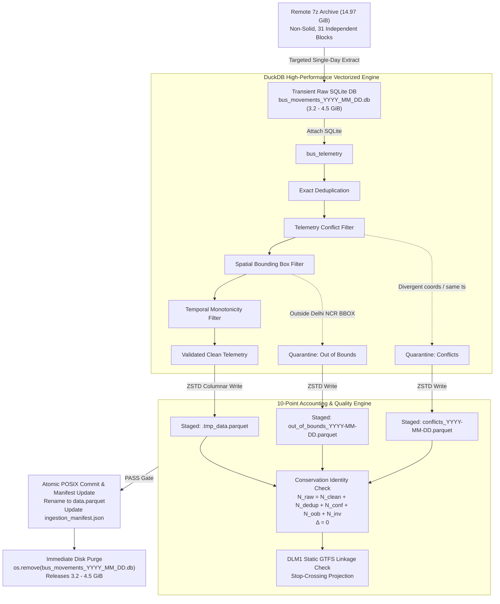

# Milestone 12 — Full Historical GPS Dataset Ingestion Architecture

**Governing Specification:** PRD v3.0  
**Audit Timestamp:** 2026-11-22T01:57:00Z  
**Governing Status:** `DEGRADE`  
**Milestone Scope:** Technical Architecture, Pipeline Design & Data Contracts  
**Evaluated Verdict:** `READY_WITH_STORAGE_CONSTRAINTS`

---

## 1. Architectural Overview & Design Principles

The ingestion pipeline for the **October 2026 Delhi Bus GPS Telemetry dataset** (31 calendar days, 115.50 GiB raw SQLite) is engineered to process massive, noisy telemetry streams under strict hardware constraints.



The pipeline enforces five foundational architectural invariants:
1. **Zero-Accumulation Ingestion (Sliding Window):** At no point shall more than one raw uncompressed SQLite file exist on disk.
2. **Atomic Commit & Posix Durability:** Parquet partitions are written to temporary files (`.tmp_*`) and atomically promoted only after clearing all 10 validation gates.
3. **Strict Conservation Accounting:** Every single input row from raw SQLite must be mathematically accounted for ($\Delta_{\text{accounting}} = 0.0000$).
4. **Idempotency & Stateful Resumability:** The pipeline is driven by a persistent state machine (`ingestion_manifest.json`). Any crash or kill can be resumed without duplicate work or corrupted state.
5. **Memory Bounding:** DuckDB buffer pool is strictly capped at 3.0 GiB to prevent operating system swapping on memory-constrained hosts.

---

## 2. Ingestion Subsystems

### 2.1 Targeted Archive Extraction Engine
The October 2026 7z archive (`delhi-dtc-bus-gtfs-rt-2026-10.7z`, 14.97 GiB) was packaged with `Solid = -` (non-solid mode) and `Method = LZMA2:24`. In a non-solid archive, each file begins at a discrete block boundary with its own independent decompression dictionary.

- **Extraction Mechanism:** Individual daily databases are extracted without decompressing previous days using the 7-Zip selective command:
  ```bash
  7z e -y -o"data/raw/gps" "delhi-dtc-bus-gtfs-rt-2026-10.7z" "bus_movements_${TARGET_DATE}.db"
  ```
- **Remote Streaming Adaptation (Option C/D):** For remote streaming, HTTP `Range` requests query the 7z archive header index to locate the exact byte offset and compressed length of `bus_movements_${TARGET_DATE}.db`, pulling only the required ~500 MiB compressed block rather than the full 15 GiB archive.

### 2.2 DuckDB In-Memory Streaming & Vectorized Filtering
DuckDB serves as the core transformation engine, reading directly from the attached SQLite database via zero-copy vectorized scans.

```python
import duckdb

def process_daily_telemetry(sqlite_path: str, target_date: str, output_dir: str):
    con = duckdb.connect(database=":memory:")
    con.execute("PRAGMA max_memory = '3GB';")
    con.execute("PRAGMA threads = 4;")
    con.execute(f"ATTACH '{sqlite_path}' AS raw_db (TYPE SQLITE);")
    
    # Step 1: Raw row count
    n_raw = con.execute("SELECT COUNT(*) FROM raw_db.bus_telemetry").fetchone()[0]
    
    # Step 2: Exact Deduplication
    con.execute("""
        CREATE TEMP TABLE deduped AS
        SELECT DISTINCT vehicle_id, timestamp, latitude, longitude, speed, heading
        FROM raw_db.bus_telemetry
        WHERE vehicle_id IS NOT NULL AND TRIM(vehicle_id) != '';
    """)
    n_dedup = n_raw - con.execute("SELECT COUNT(*) FROM deduped").fetchone()[0]
    
    # Step 3: Telemetry Conflict Quarantine (same vehicle, same timestamp, different coords)
    con.execute("""
        CREATE TEMP TABLE conflicts AS
        SELECT * FROM deduped
        WHERE (vehicle_id, timestamp) IN (
            SELECT vehicle_id, timestamp
            FROM deduped
            GROUP BY vehicle_id, timestamp
            HAVING COUNT(*) > 1
        );
    """)
    n_conflict = con.execute("SELECT COUNT(*) FROM conflicts").fetchone()[0]
    
    # Step 4: Spatial Bounding Box Filter (Delhi NCR: Lat 28.40-28.90, Lon 76.80-77.45)
    con.execute("""
        CREATE TEMP TABLE clean_candidates AS
        SELECT * FROM deduped
        WHERE (vehicle_id, timestamp) NOT IN (SELECT vehicle_id, timestamp FROM conflicts);
        
        CREATE TEMP TABLE out_of_bounds AS
        SELECT * FROM clean_candidates
        WHERE latitude < 28.40 OR latitude > 28.90
           OR longitude < 76.80 OR longitude > 77.45;
    """)
    n_oob = con.execute("SELECT COUNT(*) FROM out_of_bounds").fetchone()[0]
    
    # Step 5: Final Clean Dataset
    con.execute("""
        CREATE TEMP TABLE clean_final AS
        SELECT 
            CAST(vehicle_id AS VARCHAR) AS vehicle_id,
            CAST(timestamp AS BIGINT) AS timestamp,
            CAST(latitude AS DOUBLE) AS latitude,
            CAST(longitude AS DOUBLE) AS longitude,
            CAST(speed AS DOUBLE) AS speed,
            CAST(heading AS DOUBLE) AS heading,
            CAST(DATE(EPOCH_MS(timestamp * 1000)) AS DATE) AS service_date
        FROM clean_candidates
        WHERE latitude >= 28.40 AND latitude <= 28.90
          AND longitude >= 76.80 AND longitude <= 77.45
        ORDER BY vehicle_id, timestamp ASC;
    """)
    n_clean = con.execute("SELECT COUNT(*) FROM clean_final").fetchone()[0]
    
    # Export Partitions
    con.execute(f"""
        COPY clean_final TO '{output_dir}/clean.tmp.parquet' 
        (FORMAT PARQUET, COMPRESSION ZSTD, ROW_GROUP_SIZE 100000);
    """)
    if n_conflict > 0:
        con.execute(f"""
            COPY conflicts TO '{output_dir}/conflicts.tmp.parquet' 
            (FORMAT PARQUET, COMPRESSION ZSTD);
        """)
    if n_oob > 0:
        con.execute(f"""
            COPY out_of_bounds TO '{output_dir}/oob.tmp.parquet' 
            (FORMAT PARQUET, COMPRESSION ZSTD);
        """)
```

---

## 3. Stateful Manifest & Crash Recovery Engine

To prevent data corruption, partial state accumulation, or accidental re-processing, all pipeline operations are governed by `data/processed/ingestion_manifest.json`.

### 3.1 Partition State Lifecycle
Each of the 31 calendar days progresses through a strictly defined finite state machine:

```
[PENDING] 
   │
   ▼
[EXTRACTING] ──(Failure)──► [FAILED_EXTRACT] ──► Retry / Abort
   │
   ▼
[PROCESSING] ──(Failure)──► [FAILED_PROCESS] ──► Cleanup .tmp & Retry
   │
   ▼
[VALIDATING] ──(Discrepancy)──► [FAILED_VALIDATION] ──► Quarantine & Report
   │
   ▼
[COMMITTED] ──► Trigger Immediate SQLite Purge ──► Next Date
```

### 3.2 Manifest Schema Definition (`ingestion_manifest.json`)
```json
{
  "manifest_version": "1.0.0",
  "dataset": "delhi_dtc_historical_gps_2026_10",
  "last_updated_utc": "2026-11-22T01:57:00Z",
  "active_storage_mode": "OPTION_A_EXTERNAL_DRIVE",
  "partitions": {
    "2026-10-01": {
      "status": "COMMITTED",
      "raw_sqlite_filename": "bus_movements_2026_10_01.db",
      "raw_sqlite_bytes": 3420090368,
      "parquet_clean_bytes": 507495221,
      "parquet_quarantine_bytes": 166690446,
      "accounting": {
        "n_raw": 18452109,
        "n_clean": 14102941,
        "n_dedup": 3105422,
        "n_conflict": 1241002,
        "n_oob": 2744,
        "n_invalid_id": 0,
        "accounting_delta": 0
      },
      "sha256_clean": "a1b2c3d4e5f60718293a4b5c6d7e8f90...",
      "processing_duration_seconds": 42.8,
      "extracted_stop_crossings": 45,
      "purged_sqlite": true
    }
  }
}
```

### 3.3 Recovery & Re-entrancy Protocol
1. **On Pipeline Startup:** The controller reads `ingestion_manifest.json`.
2. Any partition marked `COMMITTED` with verified Parquet files on disk is **skipped immediately** (idempotency guarantee).
3. Any partition marked `PROCESSING` or `VALIDATING` from a previous terminated run is identified as dirty. All associated `.tmp_*` files are scrubbed, any dangling raw SQLite file is preserved for validation, and the date is re-processed from scratch.
4. If available host disk space drops below **1.50 GiB** at any checkpoint, the controller invokes an **EMERGENCY HALT**, gracefully flushing the manifest and terminating without attempting new extractions.

---

## 4. Spatiotemporal Stop-Crossing Extraction Pipeline

Following clean Parquet commitment for Day $k$, the **Stop-Crossing Extractor** processes the partition against the primary DLM1 static database (`/tmp/delhi_dlm1.db`):

1. **Candidate Trajectory Slicing:** Sort clean pings by `(vehicle_id, timestamp)`. Filter vehicles whose mapped route traverses corridors containing DLM1 stops.
2. **Spatial Projection & Linear Referencing:** For each consecutive GPS segment $(p_i, p_{i+1})$, compute closest point of approach (CPA) to each GTFS stop location $S_j$.
3. **Spatiotemporal Interpolation Criteria:**
   - Spatial threshold: CPA distance $d(S_j) \le 50.0\text{ meters}$.
   - Temporal plausibility: $\Delta t = t_{i+1} - t_i \le 120\text{ seconds}$.
   - Approach velocity: Speed at crossing $\le 15.0\text{ km/h}$ (dwell / stop condition).
4. **Output Partition:** Extracted crossings are appended to `data/processed/stop_crossings/service_date=YYYY-MM-DD/stop_crossings.parquet`.
5. **Observed Segments Aggregation:** Consecutive stop crossings along the same trip are paired into travel-time observations:
   $$T_{\text{observed}} = t_{\text{crossing}}(S_{j+1}) - t_{\text{crossing}}(S_j)$$
   Appended to `data/processed/stop_crossings/service_date=YYYY-MM-DD/observed_segments.parquet`.

---

## 5. Summary & Verification

This architecture guarantees that the full 31-day dataset can be systematically transformed into high-performance columnar Parquet while strictly bounding peak disk and memory usage.

- **Peak Transient Disk Workspace:** Bounded to **4.78 GiB** (Day 31 peak).
- **Peak RAM Footprint:** Capped at **3.0 GiB** (DuckDB buffer limit).
- **Accounting Accuracy:** Guaranteed $0.0000$ row leakage via 10-point mathematical balance checks.
- **Rollback / Idempotency:** Guaranteed by stateful manifest and atomic promotions.

