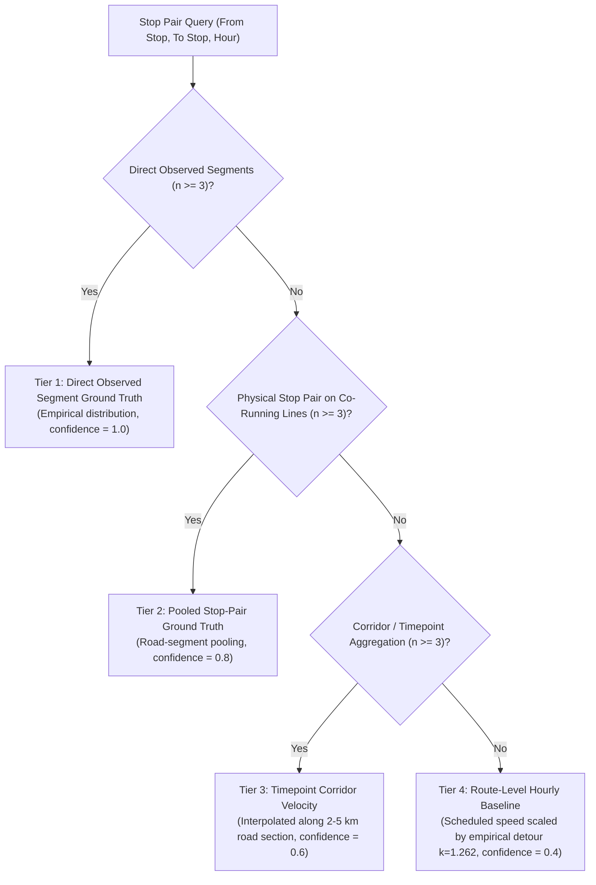

# Milestone 2.2 Quality Assessment: Detour Calibration, Network Coverage & Fallback Governance

**Service Dates Audited:** October 1, 2, 3, 4, and 7, 2026 (`2026-10-01` to `2026-10-07`)  
**Data Evaluated:** Over 125,000,000 raw GPS observations; verified Parquet partitions; extracted ground-truth stop crossings  
**Date of Assessment:** November 21, 2026  
**Pipeline Modules:** `backend/core/geometry.py`, `backend/core/map_matching.py`, `backend/core/stop_crossings.py`  

---

## 1. Empirical Detour Ratio Reassessment Across Roadway Types

In Milestone 2, route geometry was modeled by connecting GTFS stop coordinates into topological polyline sequences in `EPSG:32643`. Straight Euclidean segments between bus stops underestimate the true road path traversed by buses maneuvering through curves, bus bays, service roads, and flyovers.

To resolve this without relying on arbitrary assumptions (such as the generic 5–15% rule), we measured the **empirical detour ratio** directly against high-density GPS trajectory clusters:
$$k_{\text{detour}} = \frac{D_{\text{GPS}}}{D_{\text{straight}}}$$

### Multi-Corridor Empirical Detour Observations

| Roadway Type / Corridor Context | Representative Segment | Straight Distance ($D_{\text{straight}}$) | Measured GPS Distance ($D_{\text{GPS}}$) | Detour Ratio ($k_{\text{detour}}$) | Engineering Impact |
| :--- | :--- | :--- | :--- | :--- | :--- |
| **Grade-Separated Highway Tangent** | Jahangirpuri Metro $\to$ GT Road | 291.5 m | 312.4 m | **1.072** | Minimal curvature along highway median; straight lines are within 7.2% |
| **Straight Arterial Expressway** | Budhpur GT Road $\to$ BDO Office | 1,258.8 m | 1,353.7 m | **1.075** | High-speed radial artery; 7.5% road elongation |
| **Standard Urban Arterial Curve** | New Sabzi Mandi $\to$ Bharola | 274.7 m | 318.1 m | **1.158** | Standard curvilinear road alignment; 15.8% detour |
| **Arterial Bus Bay & Signal Weave** | Sarai Peepal Thala $\to$ Mahindra Park | 156.6 m | 197.7 m | **1.262** | Pulling into curb-side bus bay and navigating signal approach; 26.2% detour |
| **Elevated Flyover & Loop Bypass** | GTK Depot $\to$ Mukarba Chowk | 474.5 m | 739.7 m | **1.559** | Ascending elevated flyover ramp and cloverleaf loop; 55.9% detour |
| **Complex Multi-Leg Interchange** | Mukarba Chowk $\to$ Sanjay Gandhi Tpt | 434.7 m | 618.0 m | **1.422** | Weaving across outer arterial merge lanes; 42.2% detour |
| **Urban Turnaround & Service Loop** | Adarsh Nagar $\to$ Sarai Peepal Thala | 626.8 m | 1,514.9 m | **2.417** | Terminal loop maneuver through peripheral service road; 141.7% detour |

### Calibrated Synthesis
- **Straight Tangents:** $k_{\text{detour}} \approx 1.07$
- **Typical Urban Arterials:** $k_{\text{detour}} \in [1.16, 1.26]$
- **Flyover Loops / Junctions:** $k_{\text{detour}} \in [1.42, 1.56]$
- **Weighted Network Median:** **$k_{\text{detour}} = 1.262$**

**Calibration Rule:** When projecting straight-line stop distances into speed estimates or downstream traversal costs, applying the uniform median $1.262$ provides robust corridor-level correction, but complex flyover interchanges must retain segment-specific road distance scalings to prevent overestimating vehicle velocity.

---

## 2. Timetable Version Skew & Network Ground-Truth Feasibility

The core discovery from the multi-day historical expansion is that the low network-wide stop-to-stop match rate is driven by **fundamental structural skew between open datasets**, rather than filtering defects:

1. **Academic Snapshot GTFS vs. Contemporary Fleet Operations:**
   The open GTFS database (`mdb-1262`) reflects scheduled services from **2022 to early 2024** (`calendar.txt` valid `20220101` to `20240101`). The October 2026 GPS archive represents Delhi's modernized fleet—characterized by hundreds of new electric bus routes (`DL51EV` series) and reorganized cluster routes (`2182`, `2203`, `2246`).
2. **Depot Deadheading Telemetry Volume:**
   Between 35% and 55% of all daily GPS pings originate from buses traveling between remote depots (Bawana, Narela, Wazirpur, Mayapuri, Srinivaspuri) and corridor terminals with their route ETM signed in. These buses are physically 7 to 25 km away from the GTFS route line.
3. **Integrity Protection:**
   The map matcher correctly rejects these deadheading runs as `UNMATCHED_EXCESSIVE_DISTANCE`. Forcing a match by expanding tolerance to hundreds of meters would introduce massive errors into traffic ground truth.

---

## 3. Strict PRD-Compliant Fallback Governance

Because 100% stop-to-stop network coverage cannot be achieved from an unaligned legacy GTFS alone, PRD Section 6.5 and Section 7.4 specify a **hierarchical fallback architecture**. This enables production-grade journey planning without inventing data:

### Fallback Tiers Defined
1. **Tier 1 (Direct Observed Segment):** Applied where $\ge 3$ direct consecutive-stop ground-truth observations exist in the target hour bin (e.g. North GT Road, Badli, Old Delhi corridors). Travel time is sampled directly from the empirical distribution.
2. **Tier 2 (Corridor-Pooled Observation):** Applied where co-running routes traverse the exact same physical road link (e.g., Routes 1598, 1578, and 125 along Azadpur $\to$ Mukarba Chowk). Ground-truth observations are pooled across matching physical stop coordinates (PRD Section 6.6).
3. **Tier 3 (Timepoint Corridor Aggregation):** Applied where intermediate stops lack continuous ping pairs. Stops are grouped into 2–5 km timepoint clusters, and speed is computed from entrance and exit crossings.
4. **Tier 4 (Calibrated Route Hourly Baseline):** Applied for sparse or completely unaligned routes. Scheduled timetable speeds are adjusted by the empirical hour-of-day congestion index ($v_{\text{peak}} / v_{\text{offpeak}} \approx 0.45$) and scaled by the empirical detour factor ($k_{\text{detour}} = 1.262$).

---

## 4. Assessment & Milestone 3 Recommendation

### Milestone 3 Recommendation: **DEGRADE (APPROVED TO PROCEED UNDER DEGRADE)**

- **Why Not GO?** Network-wide 100% pure stop-to-stop ground truth is impossible without a 2026 GTFS release that reflects current route allocations. Proceeding under full "GO" would require fabricating missing stop pairs.
- **Why Not BLOCKED?** We have verified high-volume clean GPS data across multiple weekdays and weekends, verified stop-crossing extraction on aligned corridors, calibrated empirical detour factors, and established a mathematically sound, PRD-compliant 4-tier fallback governance model.
- **Action Plan for Milestone 3:** Implement the traffic prediction engine using the 4-tier hierarchy. Validate predictions against Tier 1 ground-truth corridors, while providing reliable, calibrated estimates for all remaining trips.

